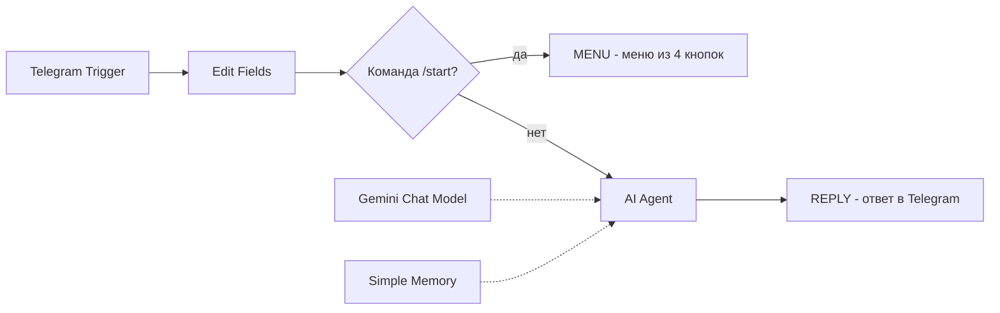
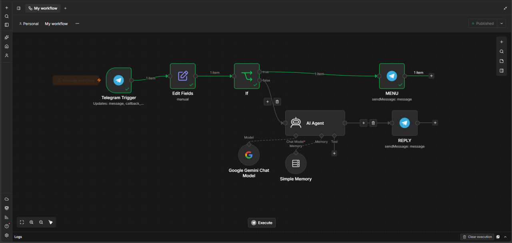

# QA Mentor: Telegram-бот на n8n

Учебный проект: Telegram-бот, который помогает в рутинной QA-работе. Собран в n8n (low-code) на модели Google Gemini. Бот я не только собрал, но и протестировал как QA: тест-кейсы, найденные баги и результаты лежат в этом репозитории.

## Что умеет бот

| Кнопка меню | Режим | Что делает |
|---|---|---|
| 🧪 Тест-кейсы | 1 | по описанию функции пишет позитивные, негативные и граничные тест-кейсы |
| 🐞 Ревью баг-репорта | 2 | проверяет, баг ли это вообще, приводит отчёт к структуре, оценивает Severity и Priority |
| 📋 Анализ требований | 3 | выдаёт учебное ТЗ со скрытыми проблемами и разбирает найденное |
| 🔌 Postman-тесты | 4 | по описанию эндпоинта пишет скрипт проверок pm.test |

Бот помнит контекст диалога (последние 10 обменов репликами) и отвечает обычным текстом, потому что Telegram не отображает таблицы.

## Как устроен

- **Telegram Trigger** принимает и текстовые сообщения, и нажатия кнопок.
- **Edit Fields** приводит оба вида событий к полям `chatId` и `text`.
- **If** отделяет команду `/start` (показать меню) от всего остального.
- **AI Agent** с моделью Gemini и памятью по chat ID отвечает по системному промпту.
- Нажатие кнопки приходит в бота служебным кодом (`mode_testcases` и т.п.), и промпт знает, что с ним делать.

Схема в n8n:

## Стек

n8n Cloud (триал), Telegram Bot API, Google Gemini (`models/gemini-3.1-flash-lite`), Postman (проверка сгенерированных скриптов на API JSONPlaceholder).

## Как запустить

1. В n8n: Workflows → Import from file → `workflow/qa-mentor-bot.json`.
2. Создать бота через @BotFather и добавить его токен в учётные данные Telegram.
3. Создать бесплатный ключ в Google AI Studio и добавить его в учётные данные модели Gemini. В облачном n8n я использовал управляемые кредиты, при импорте нужен свой ключ.
4. Нажать Publish и написать боту `/start`.

Системный промпт лежит отдельно: `prompts/system-prompt.md`.

## Тестирование

Подробности: [`testing/test-cases.md`](testing/test-cases.md), [`testing/bug-reports.md`](testing/bug-reports.md), [`postman/api-tests.md`](postman/api-tests.md).

| Режим | Результат |
|---|---|
| 1. Тест-кейсы | прогон 2 (чистая сессия): 5 из 5 Pass; прогон 1 (с накопленной историей диалога): 3 Pass, 2 Fail |
| 2. Ревью баг-репорта | 3 Pass, 1 Fail |
| 3. Анализ требований | не проводилось |
| 4. Postman-тесты | 3 запроса к API: сгенерированные скрипты прошли 5/5, 4/4 и 4/4 (один с исправлением, см. BUG-001) |

### Что я нашёл

- **BUG-001.** В режиме 4 бот иногда ставит номера перед строками кода (`1. pm.test(...)`), и Postman не может выполнить такой скрипт.
- **BUG-002.** В режиме 2 бот добавляет в «исправленный» баг-репорт детали, которых пользователь не называл (значение счётчика, точную версию браузера), и не обосновывает Priority.
- **Влияние истории диалога.** Одни и те же запросы в сессии с накопленной историей дали два провала («Ты уже запрашивал эту задачу…», отсутствие уточняющих вопросов), а в чистой сессии прошли. Вывод: тест нужно начинать с чистой памяти.
- **Качество сгенерированных тестов.** Порог времени ответа бот выбирает произвольно (500, 800, 1000 мс), а проверка Content-Type сравнивает точное значение вместе с кодировкой, что хрупко.

## Ограничения

- Учебный проект на бесплатных лимитах. Облачный триал n8n ограничен по времени, поэтому бот не работает постоянно. Работа показана на записях в `docs/demo/`.
- Память (Simple Memory) хранится внутри n8n и пропадает при перезапуске.
- Бот рассчитан на текст. Сообщения с фото и голосовые не проверялись.
- Режим 3 и часть общих проверок не тестировались.
- Ответы модели недетерминированы: один и тот же запрос может дать разный результат.

## Что улучшить дальше

- Запретить боту добавлять в баг-репорт факты, которых нет во входных данных, и требовать обоснование Priority.
- Добавить ветку для сообщений без текста.
- Команда сброса памяти диалога.
- Единое обращение на «ты» и более доброжелательный тон в режиме 2.
- Уточнить в промпте фразу «Код пользователю не показывай»: она относится к служебному коду кнопки, но допускает прочтение как запрет показывать скрипты.
